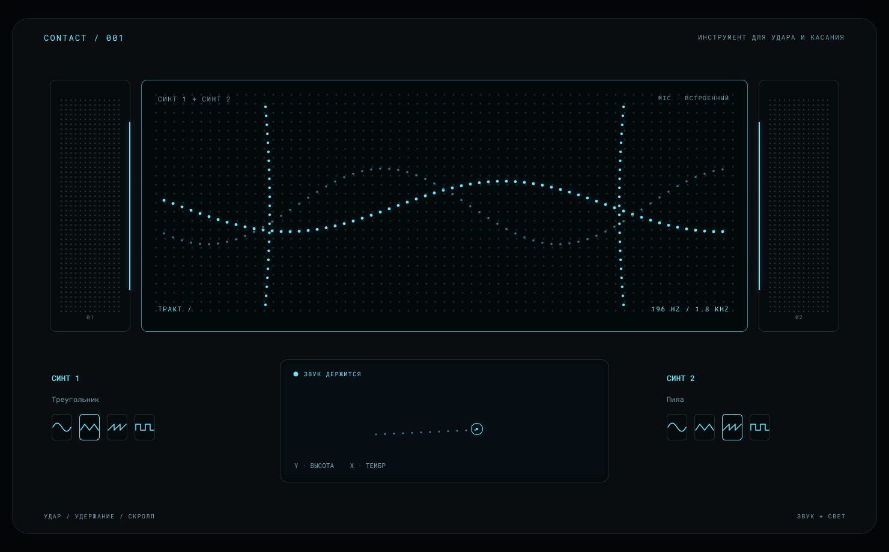
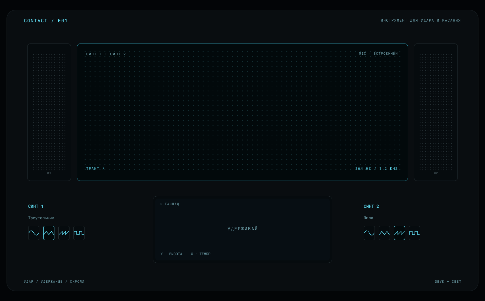
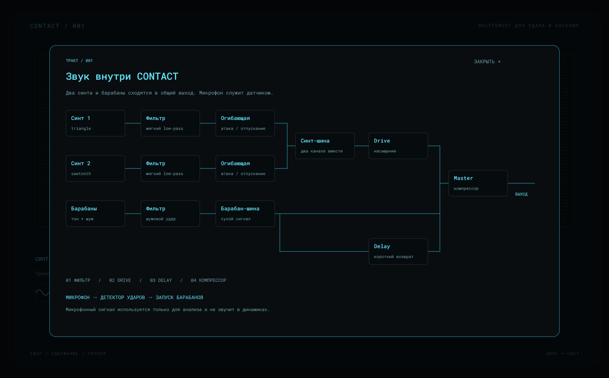

# CONTACT / 001 — концепция интерфейса

Рабочее предложение для дальнейшей сборки инструмента. Макеты показывают будущий интерфейс; готовность звука и распознавания физических жестов проверяется отдельно в браузерном прототипе.

[Макеты в Figma](https://www.figma.com/design/Pyh7GTZ3SV4cb0m6eS0mKI?node-id=8-44) · страница **02 / CONTACT — concept**.

## Визуальная идея

MacBook становится музыкальным инструментом: по его корпусу можно постукивать, на тачпаде — удерживать звук и менять его скроллом. Экран повторяет поверхность ноутбука сверху. Две боковые решётки обрамляют световую матрицу на месте клавиатуры; ниже расположен широкий тачпад.

Корпус почти чёрный, с тонкими границами и небольшими скруглениями. Неоново-голубой свет обозначает выбранную форму волны, касание и звуковой импульс. В покое остаётся тихая сетка точек. При исполнении она оживает; основной визуальный акцент — следы жестов.

Типографика — **Roboto Mono**. Короткие подписи напоминают маркировку физического прибора. Названия каналов сохраняются везде: **Синт 1**, **Синт 2**, **Барабаны**. Формы волн показываются символами, а выбранная форма подписана словами.

| Роль | Цвет |
| --- | --- |
| Фон | `#030507` |
| Корпус | `#090D10` |
| Матрица | `#02090B` |
| Границы | `#222C30` |
| Активный свет | `#64E8FF` |
| Второй план света | `#2A8B9F` |
| Подписи | `#6FA1AC` |

## Основной экран

Матрица занимает большую часть инструмента. На ней видны две линии синтезаторных голосов и короткие импульсы ударов. Линии отличаются яркостью и рисунком точек. Это условная визуализация жестов: высота и тембр меняют её положение и размах.

Слева и справа от тачпада находятся два компактных блока выбора волн. У каждого синта — четыре символа: синус, треугольник, пила и квадрат. Голубая рамка показывает выбор. Размер кнопок в макете — 56 × 44 px; они остаются доступными во время исполнения.

Удержание тачпада запускает оба голоса с общей высотой, но с отдельными источниками, формами волн и каналами. Вертикальный скролл меняет высоту, горизонтальный — тембр. Метка тачпада повторяет положение указателя; короткий след помогает увидеть его движение. Положение пальцев на физическом тачпаде браузеру недоступно.

На матрице остаются только нужные показания: названия синтов, статус микрофона, текущая частота и значение тембра. Ссылка **«Тракт»** открывает устройство звука.

## Состояния и отклик

| Состояние / действие | Предлагаемый визуальный отклик |
| --- | --- |
| Покой | Тёмная точечная сетка; подсказка «Удерживай» на тачпаде. |
| Удержание | Появляются линии двух голосов, метка контакта и статус «Звук держится». |
| Движение указателя | Метка следует за курсором; короткий след постепенно гаснет. |
| Скролл вверх / вниз | Меняются частота, вертикальное положение рисунка и отклик метки тачпада. |
| Скролл влево / вправо | Меняются тембр, размах и яркость рисунка. |
| Экранный удар | Загорается внутренний край выбранной колонки; импульс идёт от него к центру. |
| Физический удар через микрофон | Импульсы одновременно идут с двух краёв: один микрофон не определяет сторону удара. |
| Отпускание | Линии плавно затухают вместе со звуком; метка исчезает. |
| Микрофон недоступен | Вместо активного статуса появляется «MIC · OFF»; экранные зоны удара и тачпад остаются доступны. |

Начальные ориентиры для движения: появление контакта — около 60 ms, затухание после отпускания — около 240 ms, проход ударного импульса — около 650 ms. Свет не мигает постоянно в покое. При уменьшении движения в настройках системы используются короткая подсветка и статические линии.

## Панель «Тракт»

Панель раскрывает источники, соединения и порядок обработки. Каждый синт проходит через свой фильтр и огибающую, затем оба сходятся в синт-шину с насыщением Drive. Барабаны имеют отдельный канал с сухим сигналом и коротким возвратом Delay. Общий выход проходит через компрессор. Микрофон находится в отдельной управляющей ветке: детектор ударов запускает перкуссию, сам микрофонный сигнал не выводится в динамики.

Четыре категории обработки: фильтрация, насыщение, задержка и компрессия. Панель показывает структуру инструмента; управление сложными фильтрами в концепцию не входит.

## Что уже можно рассмотреть в Figma

Три редактируемых макета: **01 / Исполнение**, **02 / Покой**, **03 / Звуковой тракт**. Колонки, матрица и тачпад используют компоненты существующего эскиза. Добавлены компоненты выбора волн, блока синта и узла схемы. Цвета привязаны к палитре проекта, повторяющиеся элементы собраны в экземпляры компонентов.

В режиме прототипа Figma нажатие на тачпад в состоянии покоя показывает исполнение, «Тракт» открывает панель, «Закрыть» возвращает на основной экран. Эти переходы служат для просмотра макетов. Звук, удержание и скролл реализуются и проверяются в браузере.

## Следующий этап

1. Оценить основную композицию: размер матрицы, расположение двух синтов и тачпада, читаемость выбранных волн.
2. Перенести выбранный интерфейс в браузерный прототип и связать состояния с реальными жестами и звуком.
3. Проверить микрофонное распознавание на MacBook и поведение при отказе в доступе к микрофону.
4. Подготовить короткое исполнение и скринкаст со звуком для предпросмотра к 14 октября 2026 года, 00:00 МСК. Формат сдачи и материалы — в [PREVIEW.md](./PREVIEW.md).

Материалы для публикации на hsedesign.ru оформляются после проверки прототипа. Ссылки на GitHub и скринкаст добавляются после их появления.
