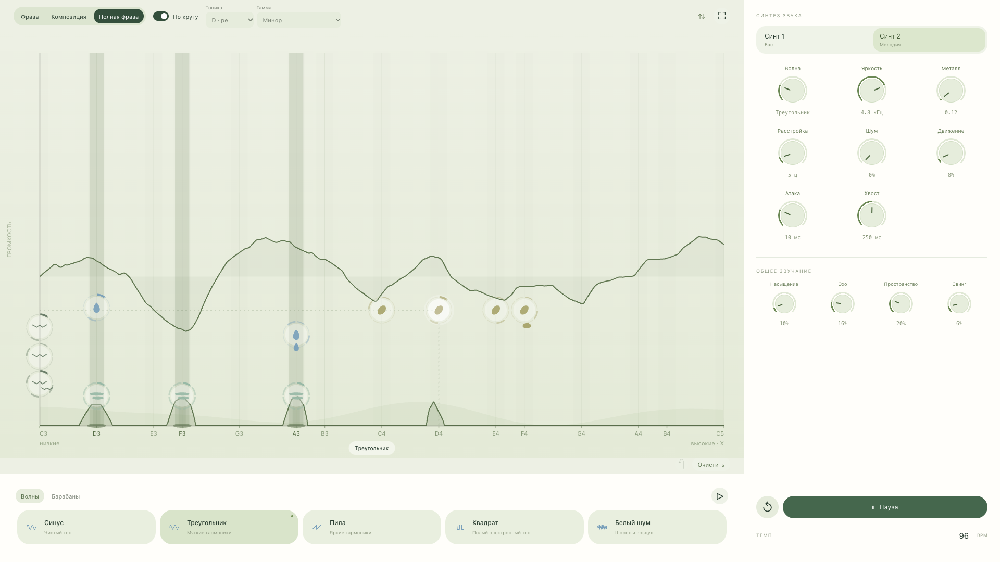
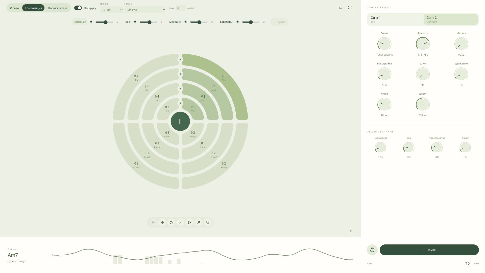
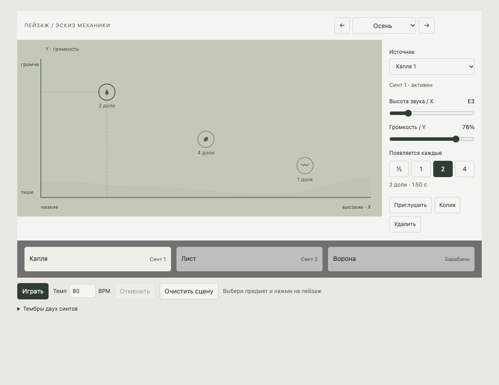

# Пейзаж — предпросмотр

Материалы для четырёх разделов задания. Дедлайн загрузки: **14 октября 2026, 00:00 МСК**. Материалы размещаются отдельными блоками в LMS; ссылка на отдельный проект может быть дополнительным блоком.

## 1. Концепция

**Пейзаж — синтезатор с пространственным редактированием нот и круговым секвенсером.**

Ноты и звуки размещаются прямо на поле с визуализацией звука. Положение по горизонтали задаёт частоту, то есть высоту тона, а положение по вертикали — громкость. Изменение этих параметров сразу можно услышать и увидеть в частотном спектре и звуковой волне. Основная идея — видеть то, что слышишь, и работать с положением звука непосредственно на поле.

На одном поле собирается повторяющаяся музыкальная фраза. Затем отдельные фразы складываются в более длинную последовательность в круговом секвенсере. Вложенные кольца позволяют соединять несколько партий: например, гармонию, бас, мелодию и барабаны. Так инструмент объединяет создание звука, редактирование фразы и исполнение композиции.

Музыкальное направление проекта — мягкий лоу-фай с элементами эмбиента: спокойное движение, приглушённые тембры, плавные огибающие и пространство между нотами. Это звучание должно поддерживать мягкий и эмоциональный характер интерфейса.

Название «Пейзаж» сохраняет первоначальный замысел: в дальнейшем музыкальное поле может стать пейзажем, который собирается из предметов. На текущем этапе эта идея остаётся возможным развитием; основной принцип инструмента — пространственное размещение нот и круговая последовательность фраз.

## 2. Прототип

На предпросмотре показывается текущая версия инструмента: поле для размещения нот, визуализация звучащего сигнала и круговой секвенсер с несколькими партиями.

В режиме «Фраза» редактируется и прослушивается отдельный музыкальный рисунок. У каждого источника выбираются доли вступления; по умолчанию фраза состоит из восьми долей, её длина меняется от одной до 32. Тоника и лад ограничивают разрешённые позиции нот, а свободный режим позволяет непрерывно менять частоту.

Кнопка **«Полная фраза»** сверху открывает выбранную фразу на большом холсте с палитрой источников и визуализацией звука. Кнопка **«Фраза»** открывает редактор под круговым секвенсером для правок во время исполнения.

В режиме «Композиция» фразы образуют сегменты колец. Их порядок меняется перетаскиванием, для каждой фразы задаётся число повторов. Кольца исполняют свои партии одновременно и проходят полный оборот за одинаковое время. Во время исполнения можно назначить следующую фразу в выбранном кольце. Общий темп управляет всей композицией.

Наиболее удачные решения текущего прототипа — круговой секвенсер и размещение нот непосредственно на поле. Основное направление доработки — управление синтезом: хочется свободнее собирать и менять собственные мягкие тембры во время исполнения.

### Устройство звука

В инструменте два независимых синтезаторных канала — **Синт 1** и **Синт 2** — и отдельный канал **Барабаны**. Для синтезированных звуков используются базовые волны: синус, треугольник, пила, квадрат, а также белый шум. Характер звука задают форма волны, примесь шума, огибающая, яркость и расстройка.

Синтезаторные каналы сходятся в цепочку эффектов синтов. Барабаны проходят через собственную цепочку с отдельными настройками. В каждой цепочке есть яркость, насыщение, эхо и реверберация; общий выход проходит через компрессию.

```text
Синт 1 ─┐
        ├→ эффекты синтов ───┐
Синт 2 ─┘                   ├→ общий выход → компрессия → звук
Барабаны → эффекты барабанов ┘

Эффекты: яркость → насыщение → сухой сигнал + эхо → + реверберация
Визуализация получает общий сигнал после эффектов и компрессии.
```

Частотный спектр показывает распределение энергии звука по частотам. Звуковая волна показывает изменение реального сигнала во времени. Визуализация помогает наблюдать результат перемещения нот и изменения тембра. Её отключение не влияет на звук.

Композиция сохраняется локально в JSON-файл, который можно импортировать обратно. В нём остаются позиции нот, ритмы, порядок фраз, партии, темп и настройки звука.

### Музыкальный эскиз

Для предпросмотра подготовлен эскиз **«Тихий круг»**: 72 BPM, четыре фразы по восемь долей, последовательность Am7 → Fmaj7 → Cmaj7 → G6. Мягкие аккорды соединяются с басом, короткой мелодией и редкой приглушённой перкуссией. Один оборот занимает около 27 секунд.

Эскиз предложен ИИ на основе заданного автором направления — лоу-фай / эмбиент. Его нужно прослушать и отстроить перед записью; это отправная точка для собственного исполнения. Партитура, параметры звуков и сценарий скринкаста находятся в [COMPOSITION.md](./COMPOSITION.md). Отдельная локальная раскладка подготовлена для импорта и не входит в публичный код.

### Работа с ИИ над прототипом

Проект разрабатывался итеративно с помощью Codex. Автор задавал концепцию, механику, расположение элементов и поведение во время исполнения. ИИ помогал переводить эти решения в работающий браузерный прототип, предлагал варианты реализации и проверял изменения. После просмотра результата автор уточнял запросы: как переключать фразы, как соотносить кольца, что должно звучать при отдельном прослушивании и какие элементы мешают управлению.

Примеры реальных запросов и уточнений из проектовых чатов:

| Запрос автора | Какое решение он задаёт |
| --- | --- |
| «Я хочу, чтобы юзер мог играть в продолжительные композиции с помощью этого синтезатора. То есть ему нужно дать несколько полей на выбор, чтобы он мог их менять по очереди» | Переход от одной повторяющейся фразы к последовательности фраз |
| «Все кольца проходят полный оборот за одинаковое время; длительность сегментов зависит от их числа» | Общий цикл для нескольких партий с разным количеством фраз |
| «При переходе в фразу и нажатии на играть должна играть только одна фраза, то есть не композиция целиком, а только одна фраза» | Отдельное прослушивание фразы при её редактировании |
| «Значительно урежем количество инструментов»; оставить «синус, треугольник, пила, квадрат и белый шум» и настройки формы волны, шума, огибающей, яркости и расстройки | Развитие инструмента в сторону самостоятельного синтеза звука |

Промпт-дизайн строился на конкретных сценариях и последовательных уточнениях. Автор определял нужное поведение и оценивал результат в интерфейсе; ИИ помогал реализовывать и дорабатывать его. Последнее направление работы — свинг и изменение звучания источников прямо во время проигрывания композиции.

Сводка составлена по доступным чатам «Добавить смену полей в композиции», «Переделать интерфейс по Figma» и «Переосмыслить интерфейс как синтез». Точная версия модели в материалах этих чатов не подтверждена.

### Ссылки и скринкаст

- [Репозиторий на GitHub](https://github.com/pentaoo/synth_zahar).
- [Открыть инструмент](https://pentaoo.github.io/synth_zahar/).
- **Скринкаст исполнения со звуком: записать и добавить ссылку.**

## 3. Интерфейс

Визуальный характер «Пейзажа» — мягкий, технологичный и эмоциональный. Светлый фон, приглушённый зелёный цвет, округлые формы и спокойная графика поддерживают выбранное музыкальное направление. По ощущению интерфейс близок к мягкости Material Design, сохраняя собственную композицию и механику.

Основные авторские решения — поле с размещением нот поверх визуализации звука и круговой секвенсер с вложенными партиями. Интерфейс организован вокруг двух масштабов работы: отдельной фразы и всей композиции.

| Компонент | Роль |
| --- | --- |
| Поле фразы | Размещение звуков; выбор частоты по X и громкости по Y |
| Спектр и звуковая волна | Наблюдение за реально звучащим сигналом |
| Отметки долей и кольца источников | Ритм вступлений и ход фразы |
| Круговой секвенсер | Последовательность фраз и одновременное исполнение партий |
| Панель синтеза и эффектов | Настройка тембра выбранных звуков и обработки каналов |
| Палитра волн и транспорт | Выбор основы звука, запуск, пауза и темп |
| Раскладки | Сохранение и импорт композиции |

Нейминг следует устройству инструмента: «Фраза» и «Композиция» обозначают масштабы работы, «Синт 1», «Синт 2» и «Барабаны» — звуковые каналы, «Бас» и «Мелодия» — музыкальные партии.

### Работа с ИИ над интерфейсом

Автор определял композицию экрана и взаимодействия, а Codex помогал воплотить их в интерфейсе. Один из реальных запросов описывал расположение элементов: «Внизу должны быть инструменты. По клику на них ты как бы условно берешь краску и потом наносишь ее на холст. Справа высвечиваются все возможные настройки».

Дальнейшие уточнения касались конкретных деталей: изменение порядка фраз через drag and drop, положение кнопок рядом с выбранным сегментом, одинаковые промежутки между сегментами и сокращение второстепенных подписей. Так авторские решения постепенно уточнялись через работающий прототип.

Подготовлены четыре скриншота текущего работающего прототипа в **1920 × 1080**. На первом из изображений ниже показаны размещение источников, звуковая волна, спектр и ручки синтеза; на втором — круговой секвенсер с четырьмя партиями эскиза «Тихий круг». Снимки сделаны во время воспроизведения.





Дополнительные кадры: [стартовая композиция из восьми фраз](./design/preview-assets/current/01-composition.png) и [редактирование фразы во время исполнения](./design/preview-assets/current/03-live-editor.png).

### Развитие дизайна

Найдены и сохранены оригинальные изображения предыдущих версий: концептуальные макеты CONTACT, первый простой браузерный «Пейзаж», интерфейс с предметами, ранние круговые секвенсеры и панель синтеза со слайдерами. Старые файлы оставлены в исходных размерах.




Для продолжения истории можно приложить [интерфейс с предметами](./design/preview-assets/old/05-landscape-objects.jpg), [первый круговой секвенсер](./design/preview-assets/old/06-first-circular-sequencer.png) и [предыдущую панель синтеза со слайдерами](./design/preview-assets/old/08-synthesis-with-sliders.jpg).

[Все 13 изображений с подписями и источниками](./design/preview-assets/README.md) · [Архив для переноса и загрузки](./design/preview-screenshots.zip).

**Актуальный макет для сдачи и ссылка на Figma ещё не готовы.**

## 4. План до конца модуля

1. **Доработать синтез звука.** Добиться выразительного мягкого лоу-фай / эмбиент звучания и понятного управления формой волны, шумом, огибающей, яркостью и расстройкой. Исследовать необычные способы изменения тембра, которые развивают пространственную концепцию инструмента.
2. **Упростить управление при исполнении.** Сделать выбор фраз и источников, настройку звучания нескольких нот и переход между фразой и композицией более удобными.
3. **Довести визуальное оформление.** Уточнить иерархию, состояния элементов и связь между положением нот и визуализацией звука.
4. **Подготовить собственную композицию и исполнение.** Развить музыкальный эскиз, отстроить тембры и баланс партий, записать скринкаст и подготовить лайв для итогового просмотра.

## Подготовка материалов к загрузке

Этот раздел — рабочий список; в презентацию входят четыре раздела выше.

- [x] Сформулированы концепция, устройство звука, интерфейс и план по ответам автора.
- [x] Подготовлена сводка работы с ИИ с реальными примерами запросов.
- [x] Подготовлены музыкальный эскиз и отдельный локальный файл раскладки.
- [x] Проверены импорт и запуск эскиза в прототипе; сохранены изображения фразы и композиции.
- [x] Сняты четыре актуальных кадра 1920 × 1080; собраны девять найденных изображений старого дизайна с подписями.
- [ ] Прослушать эскиз, выбрать и отстроить звучание для скринкаста.
- [ ] Проверить, что запись и опубликованный инструмент показывают одну версию.
- [ ] Записать скринкаст с системным звуком и добавить действительную ссылку.
- [ ] Подготовить актуальные наброски в Figma и добавить ссылку.
- [ ] Загрузить материалы отдельными блоками в задание LMS до дедлайна.

Ссылка на скринкаст и ссылка на актуальные макеты Figma остаются задачами к сдаче.
