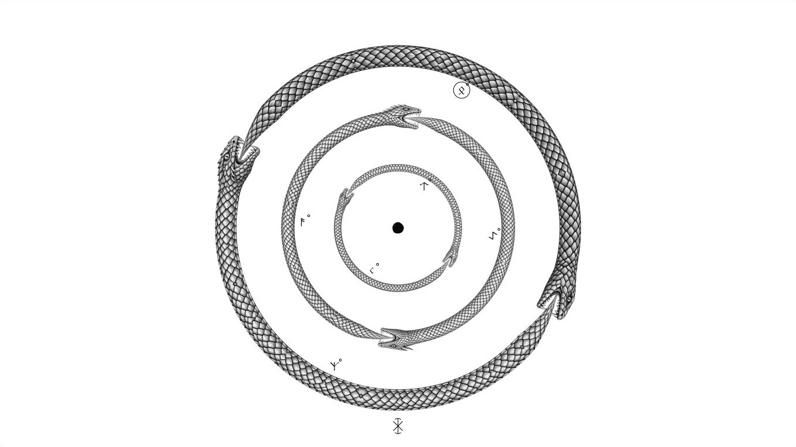
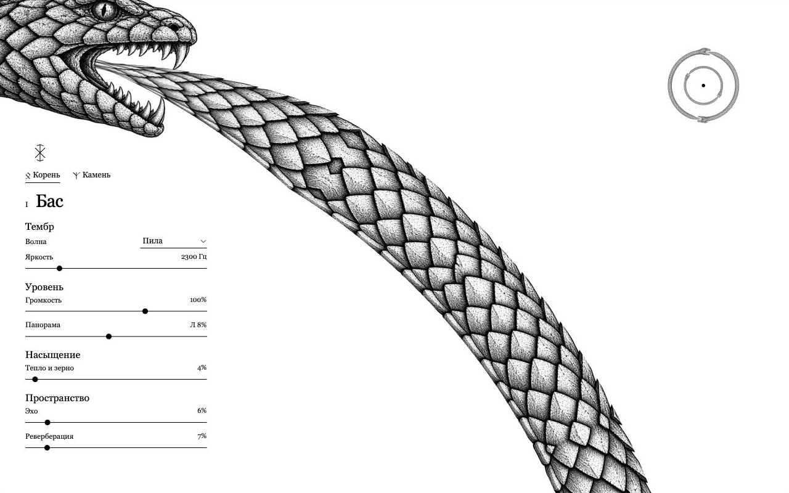
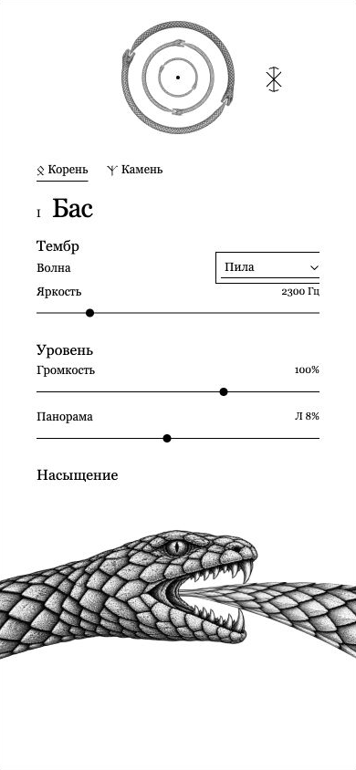
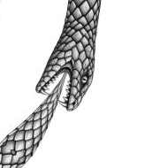
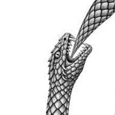
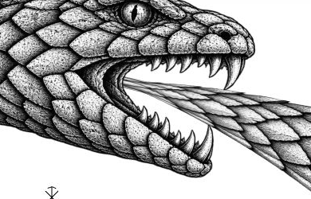
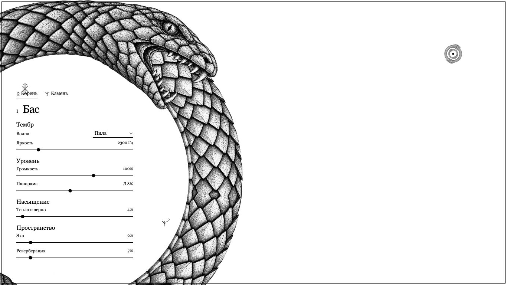
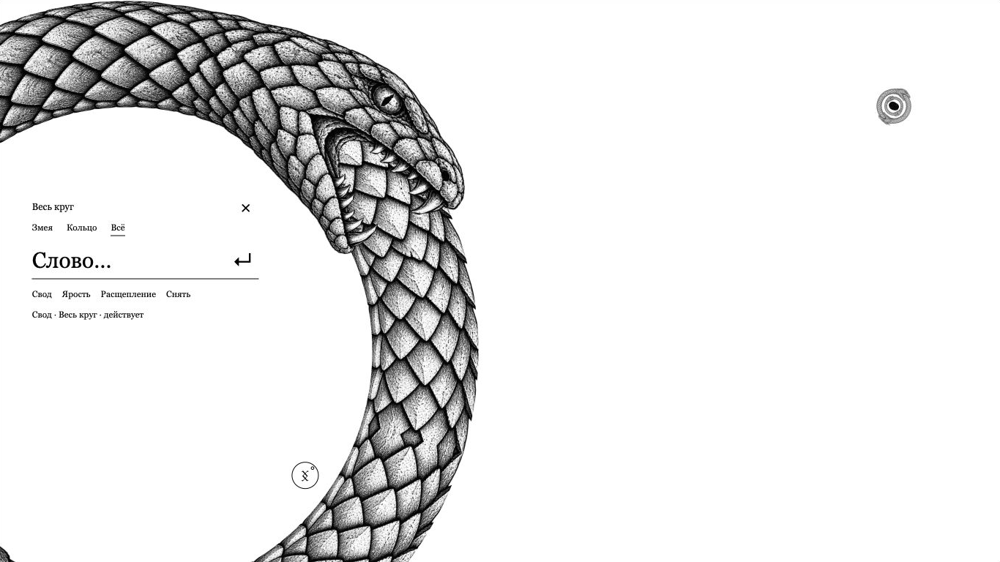

# Уроборос · результат забега 30 октября 2026

Реализовано задание `INTERFACE-RUN-PROMPT.md`: шесть оригинальных существ в трёх кольцах, две реальные фразы в каждом, слова и адресные обработки, роботизированная речь, живые глаза и отдельная мобильная композиция. Это работающий прототип для авторского просмотра. Темп, композиция, русский текст, имена существ и конкретный словарь — рабочие решения, не окончательное авторское утверждение.

## Открыть

`http://127.0.0.1:4173/sketches/ouroboros/` — инструмент. Статический сервер запускается из корня: `python3 -m http.server 4173`.

`/` → область «Змея / Кольцо / Всё» → слово → Enter. Словарь: **Свод**, **Ярость**, **Расщепление**, **Снять**. Известное слово может начать исполнение с паузы. Неизвестное остаётся для исправления. Пробел запускает и приостанавливает; в текстовом поле он печатает пробел. Escape сначала закрывает строку, затем возвращает общий вид.

Клик раскрывает кольцо, имена в настройках выбирают фразу. Drag и wheel скретчат ту же пластинку. Pinch / минус-плюс сжимают и ускоряют; дальнейшее сжатие у минимума завершает круг. На телефоне короткое касание знака открывает слово, удержание 500 мс запускает / приостанавливает. Два пальца — pinch, один — скретч. Все настройки находятся на белом поле; на невысоком экране они прокручиваются.

Полное описание музыки, маршрутизации и сценария исполнения: [README-RITUAL](../../../sketches/ouroboros/README-RITUAL.md). [Каталог существ](CREATURES.md), [реальные промпты шести атласов](../../../sketches/ouroboros/assets/ritual/GENERATION.json), [получение локальной речи](../../../sketches/ouroboros/assets/voice/GENERATION.md).

## Общий и крупный вид





Desktop показывает выбранную пару в макровиде и две оставшиеся пары в верхней правой миниатюре. Выбранный источник там не дублируется. Короткий клик отличается от drag по порогу движения; камера не меняет музыкальную позицию.



В мобильном макровиде голова находится снизу по центру, вся композиция из трёх колец — сверху по центру, включая выбранное кольцо. Это только второй рисунок тех же источников. Проверены также [360 × 800](phone-focus-360.png), [844 × 390](phone-landscape-844.png) и [ввод при доступной высоте 440 px](phone-input-390x440.png). На горизонтальном телефоне область настроек короткая и прокручивается.

## Стыки, пасть и глаз

Оба хвоста заканчиваются у глотки соседней головы. Общая геометрическая ось продолжается через шею. После последней проверки длина головы каждого нового атласа используется также при выравнивании перед распрямлением; старое фиксированное значение не создаёт маленький скачок поворота.

| Первый укус | Второй укус |
| --- | --- |
|  |  |

| Открытый глаз | Закрытое веко |
| --- | --- |
|  |  |

Это кадры настоящего моргания на неподвижной пластинке. Веко удерживает закрытое состояние 60 мс, затем открывается; графика века использует соседнюю штриховку того же атласа. Взгляд переводится в локальные координаты головы. Ни глаз, ни напряжение не запускают случайные ноты.





Ширина кожи сохраняется, видимый материал уходит в пасть. На 35% радиуса скорость составляет 2,8571×; дальнейшее сжатие приводит к конечному финалу. Слово занимает защищённую область настроек, когда те скрыты.

## Записи

Все GIF ниже получены из реальных кадров браузера. **Звука в них нет.** Они не являются измерением FPS; частота захвата ограничена снимками экрана.

- [Переход: распрямление, полный вылет, сворачивание](recordings/transition.gif).
- [Редкое моргание при постоянной музыкальной позиции](recordings/blink.gif).
- [Заглатывание и конечный коллапс](recordings/swallow-and-finale.gif).
- [Подтверждение слова и развитие воздействия](recordings/spell.gif).
- [Первый промежуточный проход](recordings/transition-first-pass.gif) сохранён как история до полировки.

## Автоматические проверки

**89 тестов — все проходят**, лог: [tests.log](tests.log).

```sh
node --test tests/ouroboros-ritual.test.cjs tests/ouroboros-revision.test.cjs tests/ouroboros-engraving.test.cjs tests/ouroboros-vinyl.test.cjs tests/ouroboros.test.cjs
```

Сохранены 69 исходных проверок, добавлены 20 содержательных проверок. Покрыты самостоятельные данные A/B и вариант 4 + 12 долей с согласованными нотами / смещениями / дугами, конечный PCM и точная сумма шести ветвей в три партии; оба читателя Vinyl / Slip в двух направлениях; оба укуса и материальные координаты при сжатии; непрерывное выравнивание новых голов перед вылетом; мобильная геометрия; моргание / reduced motion; захват двумя точками и приоритет touch перед дублирующими Safari GestureEvent / ctrl-wheel; неизвестные слова, обновление и адресация обработок, отдельное снятие фразы и сохранение соседней, независимые хвосты, актуальные постоянные параметры после снятия, речевой источник / прерывание / пауза, локальные PCM речи. В новой музыке различаются ноты и ритм A/B; у баса тихие ответы звучат поверх непрерывного дрона.

## Браузерные проверки

Проверка выполнена во встроенном браузере. [review.html](../../../sketches/ouroboros/review.html) задаёт **реальные CSS viewport внутри iframe**: 1366 × 768, 1280 × 800, 390 × 844, 360 × 800, 844 × 390 и 390 × 440. Это не эмуляция физического телефона и не проверка его User-Agent. Обычная страница отдельно проверена в доступном окне браузера.

Численные снимки состояния: [browser-evidence.json](browser-evidence.json). PNG с суффиксом `-raw` сохраняют оболочку стенда с размером; остальные — обрезки самой области инструмента. Изображения не перерисованы для отчёта.

- Выбор головы B попадает в `bass-b` по компактной маске и раскрывает её пару. Обычный drag оставляет общий вид и не открывает настройки.
- Нативный wheel создаёт отдельный виниловый сигнал: зафиксирован `texturePeak=0.04197`. Drag дал отрицательное ручное воздействие; слышимый транспорт достиг `minSpeed=-0.853`, после двух отпусканий сохранился режим Vinyl.
- Удержание чернил зарегистрировало отдельный жест. Пробел после такого удержания действительно приостанавливает весь выход, даже при фокусе на кнопке чернил: итоговый RMS `0.00000`.
- «Ярость» адресована только `bass-a`; «Свод» — всем шести фразам, произнесён локальным BufferSource. Реальный общий сигнал после эффектов был ненулевым; в заключительном прогоне RMS `0.29804`. Это подтверждение аудиопотока, не оценка музыкального баланса на слух.
- Введены клавишами `i`, `1`, `2`, `3` и пробел: в поле осталось `i123 `, музыка не запустилась, служебное окно не открылось. Неизвестное слово не изменило звук.
- Внутри viewport 390 × 844 удержание **мышью** на телефонном знаке запустило и приостановило инструмент, не открывая строку. Физическое сенсорное удержание отдельно не проверялось.
- При уменьшении доступной высоты до 440 px поле осталось доступным: его границы 196–242 px; выбранная фраза и текст сохранились. Подсказки убраны из тесного окна, голова опускается. Системная экранная клавиатура не открывалась.
- На минимуме подтверждены 35% и 2,8571×. Финал остановил транспорт / речь, общий RMS стал `0.00000`. Явный новый круг восстановил масштаб / скорость 1 и пустой слой заклинаний.
- Отдельно открыт `?transport=slip`: три канала дали ненулевой сигнал (`0.17347 / 0.09529 / 0.13571`), фоновая и слышимая позиции совпали при обычном ходе. Новые шесть ветвей работают и в сохранённом сравнительном транспорте.
- В повторной загрузке обнаружился разовый сбой декодирования атласа. Загрузчик изменён: последовательная загрузка, повтор при ошибке, проверка факта загрузки и компактная alpha-маска вместо полных RGBA-копий. После исправления повторная чистая загрузка дала шесть существ, пустой статус ошибки и паузу. Попадание в голову B проверено после изменения масок.

## Практические границы

Автору остаётся оценить на слух фолк-эскиз, баланс дрона / напева / речи и конкретный словарь. 78 BPM, A mixolydian, русский текст и синтезированный голос Milena выбраны для этой работающей версии.

Физические MacBook-тачпад и телефон не использовались. Двухпальцевый ввод покрыт модельными тестами, сжатие в браузере проверено клавиатурным эквивалентом; системная инерция, настоящая экранная клавиатура, сквозная задержка и производительность разных устройств требуют отдельной проверки. Полный финальный музыкальный скринкаст со звуком ещё не записан.

Состояние исходного скетча до этого забега сохранено в [архиве](../archive/ouroboros-before-ritual-2026-10-30.tar.gz). Несвязанные незакоммиченные файлы проекта не изменялись этим забегом.
